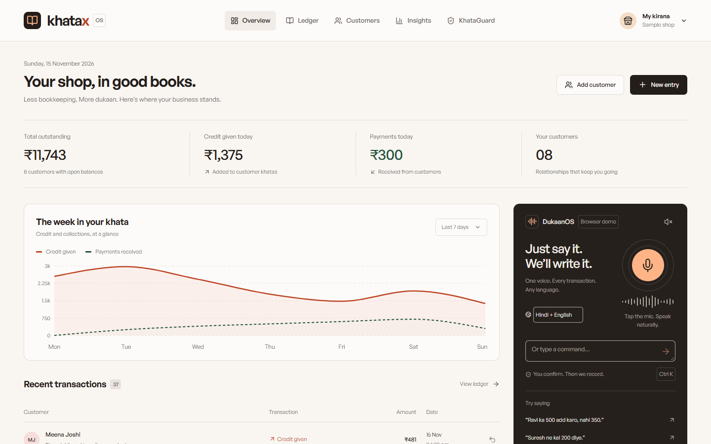

# KhataX OS

### One Voice. Every Transaction. Any Language.

**[Open the deployed app](https://khatax-os.vercel.app)** — sign in with the owner's Vercel account. The deployment uses persistent hosted SQLite.

A working multilingual voice operating system for Indian kirana stores. Speak or type an instruction, review what was understood, resolve uncertainty, and record it in an auditable financial ledger.

**The AI understands the instruction. Deterministic code controls the money. The database remembers the shop.**



## Four modules, one application

| Module           | Working capabilities                                                                                                                                                                |
| ---------------- | ----------------------------------------------------------------------------------------------------------------------------------------------------------------------------------- |
| **KhataX**       | Customer create/edit/search; credit and payments; outstanding/advance balances; history and filters; daily totals; charts; CSV export                                               |
| **BhashaBridge** | Sarvam Saaras v4 recognition for all 22 scheduled Indian languages plus English and auto-detection; Gemini language understanding with Nemotron plan review; spoken amounts, relative dates, nicknames, corrections |
| **KhataGuard**   | Amount/date clarification; identity selection; duplicate and advance warnings; explicit confirmation; undo/correction; immutable financial and audit history                        |
| **DukaanOS**     | Multi-action instructions, balance/summary questions, review, optional Gnani Timbre v3.0 spoken replies                                                                             |

Manual and voice entries use the same financial rules. Posting, editing customers, reversals, queries, filters, reports, and export operate on the real database.

## Detailed documentation

- [Architecture and voice-to-ledger sequence](docs/ARCHITECTURE.md)
- [Database tables, durable AI memory, paise arithmetic, reversals, and transactions](docs/DATABASE.md)
- [Vercel deployment, hosted SQLite, environments, and access protection](docs/DEPLOYMENT.md)
- [All 22 scheduled languages, English, provider coverage, and verification limits](docs/LANGUAGES.md)
- [Five-minute hackathon demo](docs/DEMO.md)
- [Tests, live-provider verification, and remaining limitations](VALIDATION.md)
- [Inventory, invoices, memory, forecasts, reminders, scenarios, and offline drafts](docs/BUSINESS.md)

## How the website remembers

### Guided shop conversations

Say “add a customer” or “नया ग्राहक जोड़ो” to start collecting a name, optional mobile number, and nickname. The assistant reads back the details and saves only after confirmation. For ambiguous ledger names it lists matching customers and accepts a spoken full name or option number, then asks for confirmation before posting. Say cancel to discard. After a spoken question, listening resumes automatically; mute voice replies to stop the conversation.

Replies use the recognized language. Sarvam translation supports the 22 scheduled languages plus English. Server audio uses Sarvam Bulbul for its 11 supported language codes; English retains Gnani. Other languages require an installed matching browser voice, with an explicit written-only message if unavailable. Financial values are protected during reply translation; translated prose never controls balances.

Customers, nicknames, financial entries, reversals, reviewed commands, and audit events are saved in SQLite. Refreshing the browser does not erase them. The hosted deployment uses an external SQLite database so replacing a server instance or deploying new code does not erase them either.

Each AI extraction reads the current customer directory. Balance questions and summaries use saved ledger entries through deterministic application code. A new customer is available to future commands without retraining a model. This is durable business-record memory, not unlimited chat memory or a claim that the model trains itself on the shop.

## Technology

Next.js App Router, TypeScript, React, Tailwind CSS, shadcn-style Radix components, Lucide, Recharts, SQLite, Prisma ORM, Zod, Gemini BhashaBridge understanding, NVIDIA Nemotron 3.5 Lightning plan review, Sarvam Saaras v4 STT, and Gnani Timbre v3.0 TTS. Gnani's supported STT subset and the prior OpenAI integration remain available as explicitly configured alternatives.

Local voice uses a persistent Node HTTP/WebSocket server. Vercel uses its documented native Node WebSocket lifecycle with Fluid compute. Each recording is bounded; durable financial state always lives in the database.

## Local setup

Requires **Node.js 24.x**.

```bash
git clone https://github.com/raghavg1024-stack/khatax-os.git
cd khatax-os
npm ci
```

Copy `.env.example` to `.env`. Keep `DATABASE_URL="file:./khatax.db"` for local SQLite. Put real API credentials in an ignored `.env.local` file:

```dotenv
SARVAM_API_KEY="your-local-sarvam-key"
SARVAM_STT_MODEL="saaras:v4"
NVIDIA_API_KEY="your-local-nvidia-key"
NVIDIA_MODEL="nvidia/nemotron-3.5-lightning-30b-a3b"
GEMINI_API_KEY="your-local-gemini-key"
GEMINI_MODEL="gemini-3.5-flash-lite"
GNANI_API_KEY="your-local-gnani-key"
GNANI_VOICE_ID="Shivani"
```

```bash
npx prisma generate
npm run db:setup
npm run dev
```

Open **http://localhost:3000**. Initialization applies migrations and seeds labeled sample records only when the customer table is empty. It never resets an existing ledger. The default file is `prisma/khatax.db`. Restart after changing credentials.

With NVIDIA and Gemini keys configured together, Gemini understands the original language and Nemotron reviews the normalized plan using schema-constrained JSON. Server code blocks action/amount/date disagreement. A single configured key uses that provider alone; OpenAI remains a legacy option. NVIDIA defaults to [Nemotron 3.5 Lightning](https://build.nvidia.com/nvidia/nemotron-3.5-lightning-30b-a3b/build). Create a Gemini key in [Google AI Studio](https://aistudio.google.com/apikey). Sarvam supplies the full 22-language speech catalog; Gnani supplies spoken replies and an alternative smaller recognition subset. Keys stay on the server and are never `NEXT_PUBLIC_` variables. Production credentials belong in Vercel environment variables, not Git or the deployment source bundle.

The server accepts `NVIDIA_NIM_API_KEY` as an NVIDIA alias, `GOOGLE_GENERATIVE_AI_API_KEY` and `GOOGLE_API_KEY` as Gemini aliases, plus `OPEN_AI` and `GNANI_AI` for the earlier providers. Canonical names take precedence if both forms exist. A failed provider request returns an error; it does not silently switch providers.

### Honest demo modes

Without a configured LLM key, a limited local parser handles selected patterns and spoken numbers. Without server recognition keys, supported browsers can use SpeechRecognition, or the user can type; missing Gnani TTS uses browser speech replies. These alternatives are labeled **demo**. Browser speech may use the browser vendor's online service and is not guaranteed offline.

Full code-mixed intent extraction uses the LLM. A configured provider's failure is reported; the app does not pretend a demo fallback came from that provider. Provider settings show configuration, not a guarantee of a successful paid request.

## Try it

| Command                                       | Behavior                                               |
| --------------------------------------------- | ------------------------------------------------------ |
| “Ravi ka 500 add karo, nahi 350.”             | Review ₹350 credit after correction                    |
| “Ramesh ka teen sau chaalis udhaar add karo.” | Ask which matching Ramesh is intended                  |
| “Suresh ne kal 200 diye.”                     | Past payment; clarify date if uncertain                |
| “Ravi 250 credit; Sunita paid 100.”           | Review and post two actions atomically                 |
| “Ravi ka balance batao.”                      | Read the balance from saved entries                    |
| “undo Ravi”                                   | Review reversal of the last active recorded entry      |
| “correct Ravi to 120”                         | Preserve the original; append reversal and replacement |

Natural Hindi, Kannada, Telugu, and code-mixed wording uses the configured LLM. Demo parser coverage is deliberately narrower.

## Financial guarantees in the implementation

- ₹123.45 is stored as **12345 integer paise**, not a floating-point balance.
- There is **no writable balance column** for the LLM to change.
- A saved server-side preview is separate from posting; the browser confirms by command ID.
- Ambiguous or destructive actions and warnings require explicit review/acknowledgment.
- A batch commits together or rolls back together; retrying the same posted command does not duplicate entries.
- Corrections insert linked reversals/replacements. Database triggers reject entry/audit updates and deletes.
- Daily totals use **Asia/Kolkata**. Advances are reported separately from positive outstanding balances.

See [the database guide](docs/DATABASE.md) for equations and worked examples.

## Source map

```text
src/app/api/actions/   customer operations, preview, clarify, confirm, undo
src/app/api/state/     ledger and dashboard snapshot
src/app/api/export/    auditable CSV
src/app/api/voice/     Vercel native WebSocket upgrade
src/app/api/speak/     Gnani TTS proxy
src/components/       workbench and reusable UI
src/lib/db.ts         Prisma database initialization
src/lib/ledger.ts     deterministic money and safety rules
src/lib/intent.ts     structured LLM extraction and demo parser
src/lib/voice.ts      browser capture / PCM streaming
src/lib/voice-relay.ts shared Node relay to Gnani
src/lib/audio.ts      WAV header compatibility
prisma/               schema, migrations, idempotent demo seed
tests/                isolated ledger and audio tests
scripts/              browser QA and safe provider checks
docs/                 detailed explanations
server.ts             persistent local server
vercel.json           hosted runtime settings
```

## Tests and production run

```bash
npm test
npm run typecheck
npm run build
npm start
```

On Windows, stop the running server before a build that regenerates Prisma: Windows locks its loaded engine DLL. Tests use isolated SQLite files under ignored `test-results/`, leaving shop records untouched.

Browser QA: run `node scripts/qa-server.mjs`, then `node scripts/browser-check.mjs` in another terminal. The script expects Chrome at its standard Windows installation path.

Live checks make small billable requests and never post financial entries:

```bash
node scripts/diagnose-providers.mjs
node scripts/verify-providers.mjs --speech-only --browser
node scripts/verify-providers.mjs
```

For a compiled predeployment provider test against a fresh isolated SQLite ledger, run `node scripts/qa-server.mjs --live-providers` (port 3003), then set `VERIFY_URL=http://localhost:3003` when running `scripts/verify-providers.mjs --browser`. This explicit mode uses local provider credentials but still disables the hosted database. Default browser QA on port 3001 disables all provider credentials as well.

## Deployment and verification status

The private source repository is [raghavg1024-stack/khatax-os](https://github.com/raghavg1024-stack/khatax-os). Production is deployed at **https://khatax-os.vercel.app** in the owner's `mugiwara` team. Hosted SQLite is provisioned, migrated, and verified through the deployed API. A one-paise test credit persisted across requests, and its confirmed reversal restored the original balance while preserving the audit history.

The deployment configuration selects Mumbai, Node 24, native WebSockets, and external durable SQLite. Do not use `/tmp` or a bundled SQLite file as production storage. The initial resource selection is the free Turso Starter plan. Vercel Authentication protects the single-shop deployment without a complex application login system. [Deployment instructions](docs/DEPLOYMENT.md).

Provider keys are configured in Vercel's **Production** environment, either directly by the owner or through an explicitly authorized secure copy from an ignored local environment file. The interface identifies both models when the Gemini/Nemotron pipeline is used. Sarvam takes recognition priority when configured. After adding or changing a key, redeploy the project to activate it. Missing keys produce clearly labeled demo modes.

The configured release uses Sarvam recognition, Gemini language understanding with Nemotron plan review, Gnani spoken replies, and hosted SQLite. See [the verification report](VALIDATION.md) for the tests actually completed and their limits. Sarvam accepted all 23 language selections and auto-detection in live session checks; a synthetic audio round-trip produced a matching transcript. Individual native-speaker accuracy for every language and noisy-shop microphone conditions is not certified by those checks. The legacy OpenAI path remains optional and requires its own API credits.

## Scope

This is a one-shop hackathon build. It does not implement inventory, suppliers, GST filing, money transfers, multi-tenant SaaS accounts, or unlimited conversational memory. Physical microphone quality in a noisy shop still needs a human test. A public multi-shop service requires application authentication and tenant authorization.

The original brief ended at DukaanOS “Support multiple acti…”. Multi-action commands implement the visible requirement; unseen features are not claimed. For growth, prioritize paginated aggregates, separate preview databases, backups/recovery, and real-world microphone testing while preserving the financial confirmation boundary.
