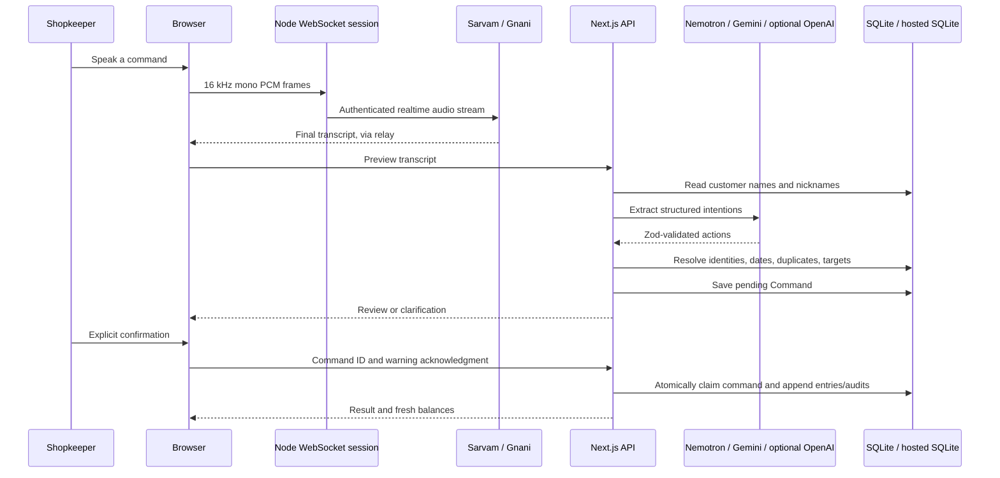

# KhataX OS architecture

KhataX OS is a single Next.js application for one kirana shop. It combines a customer ledger, speech input, structured language understanding, transaction review, and a database audit trail. The design keeps the financial rules deterministic even when the input comes from an AI model.

## The four modules

| Module       | Responsibility                                                                        | Main implementation                                                               |
| ------------ | ------------------------------------------------------------------------------------- | --------------------------------------------------------------------------------- |
| KhataX       | Customers, credit, payments, balances, history, summaries, export                     | `src/lib/ledger.ts`, `src/app/api/actions/route.ts`, `src/app/api/state/route.ts` |
| BhashaBridge | Voice transcription, code-mixed intent extraction, spoken amounts, dates, nicknames   | `src/lib/voice.ts`, `src/lib/voice-relay.ts`, `src/lib/intent.ts`                 |
| KhataGuard   | Clarification, customer identity, duplicate warnings, confirmation, reversals, audit  | `prepare()` and `commit()` in `src/lib/ledger.ts`                                 |
| DukaanOS     | A conversational entry point that can produce several ledger actions from one command | `src/components/workbench.tsx`, saved `Command` records                           |

These are product modules inside one application, not separate services.

## A transaction from speech to database

Typed input starts at the preview request and uses the same financial path. A manual entry bypasses language interpretation but still goes through review, duplicate detection, validation, and confirmation.

## What the AI does

The configured provider receives the instruction, today's date in Asia/Kolkata, and the customer name/nickname directory. With both keys present, Gemini performs native-language understanding and Nemotron 3.5 Lightning reviews the normalized plan using schema-constrained JSON. Application code rejects disagreement about action kinds, exact amounts, and specified dates. This is a plan-consistency check, not independent proof of translation accuracy. The original transcript, proposed names, and unresolved questions remain available for deterministic guards and user review. The allowed intentions are `credit`, `payment`, `balance`, `summary`, `undo`, and `correct`. Single-provider configurations remain available; labels and saved commands identify the actual path, with no silent provider fallback.

The model can propose the name, exact rupee amount as a string, date, note, and a clarification question. It cannot run SQL, call Prisma, change a balance, or authorize its own proposal. It has no database credentials and no financial execution tool.

Amounts are converted to integer paise by application code. Dates and identities are checked against the database. Posting happens only through a separate confirmed request referencing a saved command ID. The browser does not send a new action array at commit time.

## Database memory versus model memory

The database is the durable memory of the shop. It remembers customer details, nicknames, transactions, reversals, reviewed commands, and audit events across browser refreshes and deployments. The AI does not need to be trained again when a customer is added: the next extraction reads the current directory.

Balance questions are answered by application code reading the ledger. Undo/correction targets are selected from active database entries. A mixed command such as “add credit, then tell me the balance” calculates its answer after the entries are committed.

This is business-record memory. The app does not claim unlimited conversational memory, train a custom model on the shop, or put all stored transcripts into every future prompt. Command transcripts are retained for traceability; arbitrary chat preferences are not a separate memory feature.

## Server interfaces

| Endpoint                                | Behavior                                                                                                                                   |
| --------------------------------------- | ------------------------------------------------------------------------------------------------------------------------------------------ |
| `GET /api/state`                        | Customers, derived balances, entries, recent audit events, daily totals, chart data, provider configuration labels                         |
| `POST /api/actions`                     | Customer create/edit; natural-language preview; manual preview; clarification; confirmation; cancellation; selected-entry reversal preview |
| `GET /api/export`                       | CSV ledger with reversal links and signed changes in paise                                                                                 |
| `GET /api/voice` with WebSocket upgrade | Bounded binary audio relay to Gnani Prisma v3.0                                                                                            |
| `POST /api/speak`                       | Server-side Timbre v3.0 synthesis returned as WAV audio                                                                                    |

Action payloads are validated with Zod. Mutating requests reject foreign browser origins. Keys remain in server environment variables. Deployment access protection is separate from these input checks.

## Two runtime modes

### Local development

`server.ts` runs a persistent Node HTTP server. Next.js handles pages and API routes; the server intercepts the voice WebSocket upgrade and calls the shared relay. Prisma normally opens a local SQLite file. This mode is useful for offline ledger work and local hackathon development; online providers still need internet access.

### Vercel deployment

Next.js owns the deployment. The voice Route Handler uses Vercel's documented native `upgradeWebSocket()` API on Node/Fluid compute and the same relay used locally. Each speech session is capped at two minutes, within the route's three-minute duration limit. It remains a real bidirectional socket during the session; no audio polling or fake streaming is used.

Durable database state must use hosted SQLite rather than the function filesystem. A reconnect or deployment may reach a different Node instance, so no ledger balance or durable command state is held in process memory. See [deployment instructions](DEPLOYMENT.md).

## Speech formats and lifecycle

The browser captures microphone audio, converts it in an AudioWorklet to signed 16-bit little-endian mono PCM at 16 kHz, and sends 1,024-byte frames. The backend waits for Sarvam's `session.begin` or Gnani's `connected` event before forwarding audio. Sarvam receives base64 `audio_input` events and an `end` event on Stop; Gnani receives binary frames and `commit`. The relay converts provider results into bounded canonical connection, interim, final transcript, and safe error events. Cancellation closes the microphone, audio context, timers, and upstream connection.

The relay uses the official Prisma v3.0 headers, including `x-api-key-id`, language hints, model, format, and sample rate. Client disconnects close the upstream socket. A session timer closes abandoned streams. A fresh command starts a new session.

Spoken replies use Timbre v3.0 and a catalog voice such as Shivani. The browser receives WAV bytes; the server finalizes unknown-length RIFF/data headers after buffering the provider response. Spoken replies are optional and can be toggled in DukaanOS.

## Interface and scope

The workbench has overview, ledger, customer, insight, and audit views. URL parameters retain the selected tab and ledger filters. The assistant shows a review or a short clarification before posting. Loading, empty, error, disabled, and success states are implemented.

This hackathon build serves one shop. It does not include inventory accounting, supplier balances, GST filing, multi-tenant organizations, automatic collection messages, or model-controlled payments. Those are separate product decisions rather than hidden placeholder buttons.
