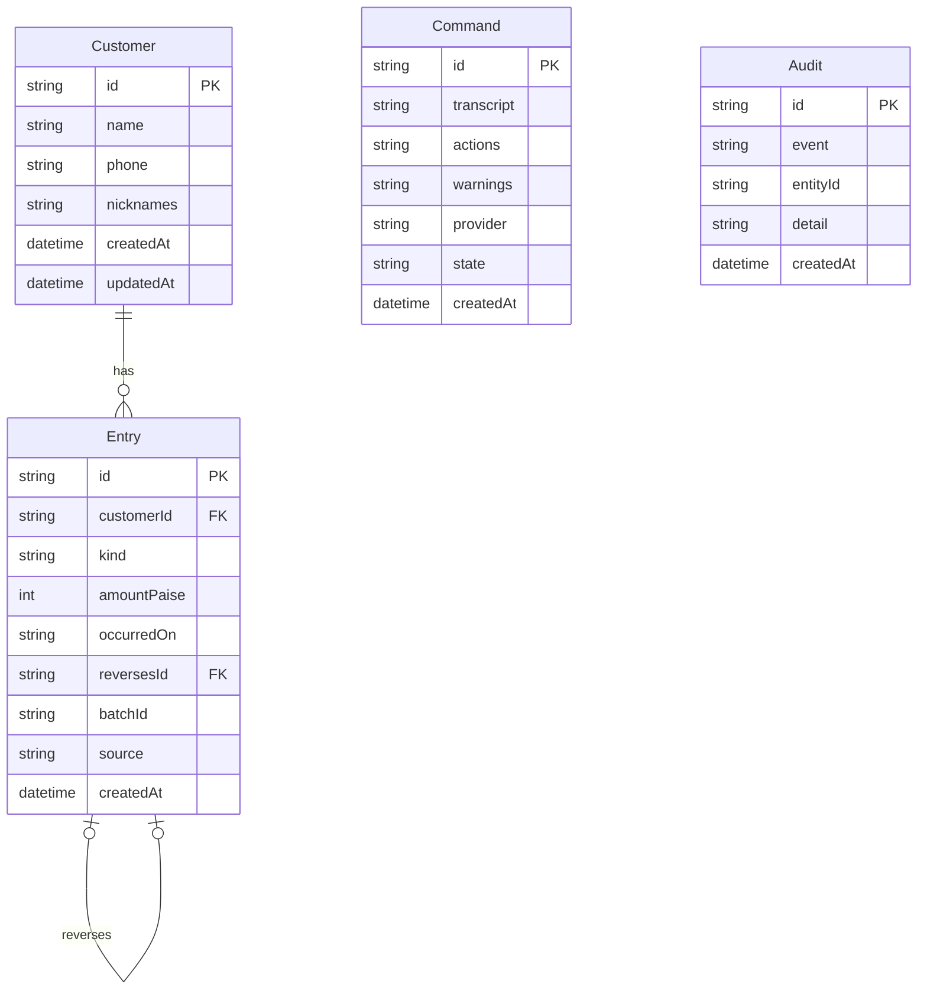

# Database and financial correctness

The database is required for KhataX OS to retain shop records. It is the source of truth; neither React state nor an LLM response is a substitute for it.

## Tables



`Command` and `Audit` use application-level identifiers to correlate events with entry batches and entities. They are shown separately in the diagram because those fields are not declared foreign-key relations in the Prisma schema.

### Customer

Customers store a full name, optional Indian mobile number, and comma-separated nicknames. Two people can share a nickname. This is intentional: shared names trigger identity clarification rather than being silently treated as the same person. Customer edits append an audit event containing before/after details.

### Entry

An entry is either `credit`, `payment`, or `reversal`.

- Credit increases what the customer owes.
- Payment reduces what the customer owes.
- Reversal stores the signed opposite of the original entry's financial effect.

An entry includes the transaction date, server recording timestamp, source, note, and optional command batch ID. `reversesId` links a reversal to its original and is unique, preventing two reversals of the same entry.

### Command

A pending command stores the transcript, resolved actions, warnings, and provider label. It can transition to `posted`, `cancelled`, or `superseded`. Clarification produces a new preview and supersedes the old one. Pending previews expire after fifteen minutes.

Saving a preview does not create a financial entry. Posting uses the saved server-side actions, not a replacement action array supplied by the browser.

### Audit

Audit events record customer changes, transaction posting, reversals, corrections, and confirmed command batches. Seeded example entries are explicitly identified as sample data. Audit details are JSON text; only the latest 150 events are loaded in the current UI, while older records remain stored.

## Integer paise

Every financial value is an integer number of paise. For example, ₹123.45 is stored as `12345`. The conversion splits a decimal string into rupees and paise; it does not multiply an imprecise floating-point amount supplied by a model.

Inputs allow at most two decimal places and must be between ₹0.01 and ₹10,00,000 per original/replacement entry. Negative amounts, scientific notation, zero, and extra decimal places are rejected.

Charts convert paise to rupees for display only. The ledger and totals use paise.

## Derived balances

There is no writable `balance` column.

```text
signed(credit)   = +amountPaise
signed(payment)  = -amountPaise
signed(reversal) = stored signed amountPaise

customer balance = sum of every signed entry for that customer
```

A positive balance is outstanding credit. A negative balance is an advance. The dashboard's total outstanding sums positive customer balances; advances are reported separately so they do not conceal money owed by other customers.

Example:

| Entry               | Signed effect | Resulting balance |
| ------------------- | ------------: | ----------------: |
| Credit ₹340         |        +34000 |              ₹340 |
| Payment ₹200        |        -20000 |              ₹140 |
| Reverse the payment |        +20000 |              ₹340 |

## Corrections preserve history

Correcting ₹500 credit to ₹350 creates two new entries:

1. A reversal with effect `-50000`, linked to the original ₹500 credit.
2. A replacement credit of `35000`, with an audit link to the original/reversal.

The original row remains unchanged. The net financial effect is ₹350. Correcting an amount without a new date preserves the original transaction date. Reversal recording timestamps still show when the correction happened.

SQLite triggers reject updates or deletes to financial entries and audit records. Another trigger checks the allowed entry kinds and amount rules. These protections exist in the database as well as in the API.

## Atomic confirmation and retries

Confirmation runs inside a database transaction:

1. Load the saved pending command and check expiry.
2. Reject unresolved clarification or unacknowledged warnings.
3. Claim the command by changing its state from pending to posted.
4. Recheck reversal targets and possible duplicates.
5. Insert every financial entry and its audit record.
6. Calculate any requested balance/summary answers after the writes.
7. Commit the entire batch together.

If an action fails, the inserts and command claim roll back together. Retrying an already posted command returns an idempotent result without posting another batch. This protects retries of the same command ID; separate similar commands still pass through duplicate detection and review.

## Dates and summaries

All daily boundaries use Asia/Kolkata. `occurredOn` is an ISO calendar date and must be real and no later than today. `createdAt` records when the server stored the entry.

The seven-day chart and daily credit/payment totals count active original entries after reversals. They are an operational view of the corrected ledger, not a historical accounting close report. The full ledger/audit trail preserves the original entries and when corrections occurred.

## Local and hosted storage

Local development uses `prisma/khatax.db` with Prisma's SQLite connector. Vercel needs a network-accessible hosted SQLite database because local function storage is not durable. Turso/libSQL retains the SQLite data model while storing records outside deployment instances.

Prisma Migrate targets local SQLite. Hosted libSQL migrations are applied with a migration script using the checked-in SQL files. The production database must be initialized before the app is treated as live. Migrations should record an applied checksum and reject changes to already applied files.

Existing local data should be copied deliberately into an empty hosted database, preserving IDs, timestamps, reversal links, command state, and audit events. Re-running initialization must not reset or silently duplicate customer/financial data. Local development remains a separate database unless configured to use the hosted database explicitly.

## Growth limits

The current dashboard reads the full ledger to derive balances and charts. This is straightforward for one small shop and prevents cache drift. For large ledgers, add pagination, indexed aggregate queries, and materialized summaries with reconciliation checks. Do not replace append-only records with model-generated balances as a shortcut.
